# HIM Workbench

Local-first tools for Health Information Management (HIM) work: find possible duplicate patient records, look up ICD-10-CM and HCPCS Level II codes, and ask about both in plain English through a model running on your own machine.

**Synthetic data only. Not for clinical use, billing, or coding decisions.** This is a learning and portfolio project. Nothing here has been validated for real patient data.

## What it does

| Piece | What it does |
|---|---|
| Duplicate matcher | Scores pairs of patient records and labels each `match`, `review`, or `non-match`. Says why when it holds a pair back for a person to look at. |
| ICD-10-CM lookup | Looks up a code, or searches by plain-English text ("type 2 diabetes kidney"). Reads the public CDC/NCHS code file; the file is not bundled. |
| HCPCS Level II lookup | Same idea for supplies, DME, ambulance, and other non-CPT services ("wheelchair" -> E0100-range codes). Reads the public CMS alpha-numeric file; the file is not bundled. No CPT. |
| Assistant | A local Ollama model that answers by calling the tools above. Every tool result is printed raw, so you can check the model's retelling against the source. A dropdown next to the prompt bar picks a narrower, single-purpose agent instead of the default do-everything one — see "Narrow-job agents" below. |
| Data-quality report | Counts missing values and format problems (impossible dates, malformed zips, odd names) and exact same-name-and-birth-date groups. Counts only, never patient values. |
| SMART on FHIR (live, optional) | Connects to a public SMART on FHIR sandbox over a real OAuth2 App Launch (PKCE), pulls one live synthetic test patient, and shows their chart. Read-only. See "SMART on FHIR" below. |
| CCD / C-CDA reader | Reads a C-CDA XML document (CCD, discharge summary, referral note) into the same patient and chart the FHIR reader builds. Says how each section was read, what the document states that is not a list item, and what a CCD is missing. Local files only. See "CCD / C-CDA documents" below. |
| HIPAA self-assessment | A Security Rule checklist (45 CFR 164 Subpart C) pointed at this project, with each claim verified against the code. Says plainly what is not met (no user accounts, no encryption at rest). Not an audit. See `docs/hipaa-self-assessment.md`. |
| Audit log | Every tool call is appended to `logs/audit.jsonl`: tool name and counts only, never patient data or question text. |

## Principles

- **Synthetic data only.** Synthea-generated patients. No real patient data, ever.
- **Local by default.** Models run through Ollama on your own machine. Nothing is sent to a cloud service.
- **Tool results are the source of truth.** The model may only answer code and duplicate questions through tools. A code in an answer that no tool returned gets flagged.
- **Say what you did.** Tools report only what they actually did. A search that dropped a word says which one.
- **Public sources only.** Built from published methods and public code sets.

## How it fits together

```mermaid
flowchart TB
    you(["You"])

    subgraph ui["Interfaces: this computer only (127.0.0.1)"]
        web["Web UI: webapp.py<br/>tabs, patient charts, ROI tracker, referrals, document search, prompt bar"]
        cli["Terminal tools: scripts/"]
    end

    subgraph brain["Assistant: assistant.py"]
        asst["Tool-calling loop<br/>Grounding check flags any code no tool returned"]
        llm["Ollama<br/>local model"]
    end

    subgraph core["Core modules: src/him_workbench"]
        match["matching.py<br/>duplicate matcher"]
        qual["quality.py<br/>data quality"]
        icd["icd10.py<br/>code search + did-you-mean"]
        hcpcs["hcpcs.py<br/>HCPCS Level II search"]
        load["data.py, fhir.py, cda.py<br/>patient loaders (FHIR JSON, C-CDA XML)"]
        chart["chart.py<br/>FHIR patient chart"]
        roi["roi.py<br/>ROI request tracker"]
        ref["referrals.py<br/>referral tracker"]
        notes["notes.py<br/>generates a note per patient<br/>from their own chart data"]
        docs["docsearch.py<br/>semantic note search"]
    end

    subgraph net["Internet, opt-in only: --drugs, --education"]
        rx["rxnorm.py"] -.-> nlm1(["NLM RxNorm API"])
        ml["medlineplus.py"] -.-> nlm2(["MedlinePlus"])
    end

    subgraph localnet["Local only: this computer's Ollama"]
        emb["embeddings.py"] -.-> ollemb(["Ollama<br/>embedding model"])
    end

    audit[/"audit.py: logs/audit.jsonl<br/>tool names only"/]

    subgraph data["Local data: data/ (gitignored)"]
        syn[("Synthea patients<br/>CSV or FHIR")]
        codes[("ICD-10-CM codes<br/>CDC file")]
        hcpcsfile[("HCPCS Level II codes<br/>CMS file")]
        roidb[("ROI requests<br/>SQLite: roi.db")]
        refdb[("Referrals<br/>SQLite: referrals.db")]
    end

    you --> web
    you --> cli
    web -->|prompt bar, incl. ask about this patient| asst
    web -->|reads/writes directly, no model| roi
    web -->|reads/writes directly, no model| ref
    web -->|reads directly, no chat model| docs
    cli --> asst
    asst <-->|chat and tool calls| llm
    asst -->|local tools, incl. patient_chart| core
    asst -.->|search_drug, disease_education| net
    web -.->|chart About links: code only| net
    asst -->|every tool call| audit
    load -->|reads| syn
    load --> match
    load --> qual
    load --> chart
    icd -->|reads| codes
    hcpcs -->|reads| hcpcsfile
    roi -->|reads/writes| roidb
    ref -->|reads/writes| refdb
    notes -->|reads| chart
    docs -->|embeds via| emb
    docs -->|notes come from| notes
```



- Everything outside the dotted lines runs on your computer. The internet connections are off unless you start the app with `--drugs` or `--education`, and they send only the drug name, code, or disease name you asked about — never patient information. Document search's embedding calls go to Ollama on this machine only, same as the chat model; nothing leaves your computer.
- The assistant never answers from the model's memory: codes, duplicates, data-quality numbers and chart data come from the tools, and the raw tool results are shown next to the model's answer.
- The ICD-10 search suggests close words for a misspelled term instead of silently searching a different one; the model is never allowed to swap a word in on its own.
- The web UI's tabs (Patients, Duplicates, Data quality, Codes), the ROI request tracker, the referral tracker, and document search call the core modules directly, with no chat model involved. Only the prompt bar — including "ask about this patient" on a chart page — goes through the assistant.
- Document search does not call the chat model to create anything: a note's text is templated from a patient's own already-loaded chart data, and only the embedding model (a separate, smaller local model) is used, purely to rank notes by meaning. No record is ever created from a model's output — same reasoning as keeping ROI and referral logging form-only.

### Narrow-job agents

The assistant isn't one fixed personality — `assistant.py` defines a handful of agent *profiles*, each a trimmed system prompt paired with only the tools for its own job:

| Agent | Tools it has | Tools it doesn't have |
|---|---|---|
| General (default) | everything below | — |
| Codes | `search_icd10`, `lookup_icd10`, `search_hcpcs`, `lookup_hcpcs` | duplicates, drugs, education, charts |
| Duplicates & data quality | `scan_duplicates`, `data_quality_report`, `compare_patients` | codes, drugs, education, charts |
| Drugs & patient education | `search_drug`, `disease_education` | codes, duplicates, charts |
| Patient chart | `patient_chart` | codes, duplicates, drugs, education |

A dropdown next to the prompt bar picks which one to ask (only showing the agents whose tools are actually loaded — "Drugs & education" only appears with `--drugs`/`--education`, "Patient chart" only with `--fhir`). Each agent keeps its own separate conversation, so asking "Codes" something doesn't drag duplicate-matching context into it or vice versa, and each one's system prompt only has rules for the job it can actually do — a codes question can't end up reasoning about data-quality rules it was never given. The web UI builds one `Assistant` per agent, lazily, sharing the same underlying tool-calling loop and the same grounding check (a code in the answer that no tool actually returned still gets flagged, regardless of which agent answered). The CLI (`scripts/assistant_cli.py`) and the library itself default to the "general" profile unless you pass `profile=` explicitly, so nothing about existing scripts changes.
- The audit log records which tool ran, never the question, the drug name, the code, any patient details, a note's text, or anything about an ROI request or referral.

## Setup

Needs Python 3.11+ and, for the assistant, [Ollama](https://ollama.com) running locally.

```
python3 -m venv .venv
source .venv/bin/activate
pip install -e .
pip install pytest
pytest
```

### Get data (not included in the repo)

```
./scripts/generate_synthea.sh        # synthetic patients (needs Java 17 and the Synthea jar)
./scripts/fetch_icd10.sh             # ICD-10-CM code descriptions from CDC/NCHS
./scripts/fetch_hcpcs.sh             # HCPCS Level II alpha-numeric file from CMS (no CPT)
```

Synthea's jar location defaults to `~/Documents/Synthea/synthea-with-dependencies.jar`; set `SYNTHEA_JAR` to change it. Both downloads land in `data/`, which is gitignored.

### Try it

```
python scripts/icd10_cli.py E11.9
python scripts/icd10_cli.py "type 2 diabetes kidney"
python scripts/evaluate_matching.py          # single-error duplicates
python scripts/evaluate_hard.py              # two-error duplicates and look-alike people
python scripts/quality_report.py             # missing values and format problems
python scripts/model_check_cli.py --models gemma4:e4b,qwen3.5:9b   # fixed questions, pass/fail per model
ollama pull gemma4:e4b
python scripts/assistant_cli.py --model gemma4:e4b --demo-dups
```

`--demo-dups` injects 15 known duplicates (ids start with `dup-`) so there is something to find. Set `HIM_MODEL` to skip the `--model` flag, or `OLLAMA_HOST` to use Ollama on another machine.

### Drug name lookup (optional, uses the internet)

```
python scripts/assistant_cli.py --model gemma4:e4b --drugs
python scripts/ui_cli.py --model gemma4:e4b --drugs
```

Adds one tool, `search_drug`, that looks up drug names and RxNorm IDs through NLM's public RxNorm API (no key or license needed for these endpoints). **The drug name you ask about is sent to NLM's servers**, so it is off unless you pass `--drugs`. It returns names, types and IDs only: no doses, interactions, or advice. Results are cached on this computer for 24 hours in `data/cache/` (gitignored). RxClass is not used, because it carries SNOMED CT content under a separate license.

> This product uses publicly available data from the U.S. National Library of Medicine (NLM), National Institutes of Health, Department of Health and Human Services; NLM is not responsible for the product and does not endorse or recommend this or any other product.

### Disease education (optional, uses the internet)

```
python scripts/ui_cli.py --model gemma4:e4b --education
```

Adds one tool, `disease_education`, that takes an ICD-10-CM code or a disease name and returns the matching patient-education pages from NLM's MedlinePlus Connect service: title, a short summary, and a link to the MedlinePlus page. **The code or name you ask about is sent to NLM's servers**, so it is off unless you pass `--education`. A code uses MedlinePlus Connect; a name searches MedlinePlus Health Topics. Results are cached on this computer for 24 hours in `data/cache/` (gitignored). Summaries are shortened and always link back to MedlinePlus; pages are not copied. Not medical advice.

> Health information from MedlinePlus.gov, a service of the U.S. National Library of Medicine. NLM is not responsible for this product and does not endorse or recommend it.

### Reading FHIR patients (local)

```
FHIR_EXPORT=true ./scripts/generate_synthea.sh                 # also writes FHIR bundles to data/synthea/fhir/
python scripts/ui_cli.py --model gemma4:e4b --fhir data/synthea/fhir
```

### Patient chart (FHIR)

`python scripts/chart_cli.py data/synthea/fhir/SOME_PATIENT.json` prints one patient's chart from a Synthea FHIR bundle: active problems, medications, allergies, the most recent vitals and labs, recent visits and immunizations. Disorders are separated from findings and situations by the SNOMED type tag in the display name, so "Medication review due (situation)" does not appear as a disease. The tag cannot tell clinical findings (prediabetes, obesity) from social ones (employment, stress), so those are listed together under "Other findings and social history", not hidden. Resource types the chart does not show (claims, imaging, and so on) are counted at the bottom, not hidden. In the web UI, started with `--fhir`, patient names on the Patients page link to the same chart. With `--education` also on, each problem and medication gets an About link to a MedlinePlus page: problems by SNOMED CT code (then by name if MedlinePlus has no page for the code), medications by RxNorm code. Only that code, and the problem name when the code finds nothing, is sent to NLM, never patient information. Without `--education` the chart makes no network calls. Synthetic data only.

#### Ask about this patient

With `--fhir` and a model chosen, the prompt bar on a patient's chart page says "Ask about <first name>'s chart". Questions there go to the same assistant, which gets one extra tool, `patient_chart`, that returns that patient's chart from their FHIR file. The raw chart data it used is shown next to the answer. Rules it follows: answer only from the chart, say so when the chart does not have the answer, never say a lab value is normal or abnormal (these files carry no reference ranges), and never diagnose or advise. Each vital and lab comes with its most recent value and up to ten earlier ones, so the assistant can report values over time, but it describes values and dates only and never calls a change better or worse. Multi-part observations such as blood pressure are read part by part. Social-history observations (tobacco status) and screening questionnaires (PHQ-2/9, GAD-7, AUDIT-C, DAST-10, PRAPARE items) are read and shown, and the assistant reports their scores as recorded and never says what a score means. Any observation type still not read is listed by name, so the assistant says "not read" and not "not in the chart". The assistant's context window is set to 16384 tokens (override with `HIM_NUM_CTX`), because a whole chart is large and Ollama cuts off silently past its window. Everything stays on this machine.

`--fhir PATH` (on `ui_cli.py` and `assistant_cli.py`) reads FHIR Patient resources instead of the Synthea CSV: a single Patient, a Bundle, or NDJSON (as in the FHIR Bulk Data export), from a file or a whole folder. It runs locally and makes no network calls. It prints what it read and what it left out (deceased, no usable name, unreadable files). Mapping follows US Core Patient: official name first, `male`/`female` to M/F (`other` and `unknown` stay blank so they never count as a conflict), partial birth dates kept as written, `postalCode` kept as written.

### SMART on FHIR (web UI, live, optional, uses the internet)

Everything above reads FHIR data from local files. The **SMART on FHIR** link instead connects live to a public SMART on FHIR sandbox — the actual OAuth2 App Launch flow (standalone launch, PKCE/S256), not a file import — and pulls one of the sandbox's own synthetic test patients straight from its FHIR server. It's read-only: nothing is ever written back to the sandbox.

Clicking Connect sends your browser to the sandbox's own authorize/patient-picker page; the sandbox sends you back once you pick a patient, and the chart is fetched live and rendered the same way as a local FHIR chart (Problem list, Medications, Allergies, Vitals, Labs, Visits, Immunizations) — it's the same `chart_from_resources()` code underneath, just fed resources from live HTTP calls instead of a file. The authorization and token endpoints are never hardcoded: they're read at connect time from the server's own `.well-known/smart-configuration`, the way a real SMART client is supposed to discover them, since those paths are the sandbox's own to define.

Defaults to [SMART Health IT's public sandbox](https://launch.smarthealthit.org/), which needs no app registration — any `client_id` is accepted. The default FHIR server URL has a `/sim/<encoded>/` segment baked in: that's this launcher's own way of carrying launch config (standalone, not EHR launch; no patient pre-picked; PKCE required) — a plain `/v/r4/fhir` base isn't a valid standalone-launch server on its own for this launcher, confirmed against the real sandbox. [Launch the sandbox's own form](https://launch.smarthealthit.org/) and copy its generated "FHIR Server Base URL" if you want a different sim configuration. Override with `HIM_SMART_ISS` / `HIM_SMART_CLIENT_ID` to point at a different sandbox entirely (Epic on FHIR, Oracle Health/Cerner, etc.), which may require a client_id you've actually registered there. Disconnecting clears the in-memory token; nothing from a SMART connection is written to disk.

### CCD / C-CDA documents (CLI and web UI)

FHIR is JSON resources; C-CDA is one XML document with a header and a body of sections, and it is still what most care summaries and transitions of care are sent as. `cda.py` reads one into the same `Patient` and `Chart` the FHIR reader builds, so the chart views and the assistant's chart tool work on it unchanged.

```
python scripts/ccd_cli.py tests/fixtures/sample_ccd.xml          # terminal report
python scripts/ui_cli.py --ccd PATH                              # web: "CCD documents" page (one .xml file or a folder)
```

Sections are found by LOINC code: Problems (11450-4), Allergies (48765-2), Medications (10160-0), Vital signs (8716-3), Results (30954-2), Social history (29762-2), Immunizations (11369-6), Encounters (46240-8). The reader uses the coded `entry` elements, and goes to the narrative table only to find a name an entry points at (`originalText/reference`). Codes are kept as the document gives them, with the code system shown as the usual FHIR system URI.

The report also says what the reader did not take:
- **Not mapped:** any other section (procedures, plan of treatment ...) is counted under "not shown", not dropped silently.
- **Narrative only / nullFlavor:** a mapped section with text and no coded entries is counted as not read; a section marked `nullFlavor="NI"` is reported as the document giving no information.
- **Statements, not list items:** "no known allergies", "no known problems", a negated entry, and a refused immunization are listed under "The document also states" and are never added to the lists.
- **Checks:** a CCD (templateId 2.16.840.1.113883.10.20.22.1.2) is checked for the six sections the [C-CDA on FHIR CCD profile](https://hl7.org/fhir/us/ccda/StructureDefinition-Continuity-of-Care-Document.html) lists as required (allergies, medications, problems, results, social history, vital signs); other document types are read with the same mapping but not held to that list. Also checked: US Realm Header, patient id, name and birth date in the header, `nonXMLBody` documents, and entries coded in a system other than the expected one (a medication coded in NDC instead of RxNorm).

Limits: medications keep name, status and start date, not dose, route or frequency; reference ranges and interpretation flags are not read; every entry in the Problems section goes on the problem list whatever its type; codes are not translated between systems; this is a reader, not a validator, so it does not check a document against the full C-CDA schematron. A document with a DOCTYPE or ENTITY declaration is refused (entity-expansion and external-entity attacks), as are files over 50 MB and UTF-16/32 files. The sample in `tests/fixtures/` is invented; the parser was also run over the public [HL7 C-CDA example documents](https://github.com/HL7/C-CDA-Examples), which are not bundled here.

### HIPAA Security Rule self-assessment

```
python scripts/hipaa_assessment_cli.py                                   # summary and biggest gaps
python scripts/hipaa_assessment_cli.py --write docs/hipaa-self-assessment.md
```

Lists every standard and implementation specification in the HIPAA Security Rule (administrative, physical, technical), marks it met, partly met, not met, not applicable, or organizational (things software cannot show, such as training and contracts), and gives the evidence and the gap. Rows with checks are verified against the repo: if the code stops showing a claim, the row turns into RE-CHECK, and that includes "not met" rows (add a login and the no-authentication rows flag themselves). A test fails if the committed report drifts from the code. This project handles synthetic data only, so HIPAA does not apply to it; the report answers what would have to be true first. It is a self-assessment, not an audit or legal advice. Result today: the technical gaps are real: no user identity, no automatic logoff, no encryption at rest.

### ROI request tracker (web UI)

The **ROI requests** link in the web UI tracks release-of-information requests: someone asks for a patient's records, the clinic checks who they are and whether they may see them, then answers inside a deadline. Each request records the patient (one of the loaded synthetic patients), who is asking, what was requested, the date received, the due date and a dated history. Rules the tracker enforces: a request cannot be fulfilled before it is verified; a denial needs a written reason; closed requests cannot be reopened; the deadline can be extended once, on or before the due date. Open requests show days left or days overdue. The deadline is 30 calendar days by default and one 30-day extension is allowed, which follows the [HHS page on the HIPAA right of access](https://www.hhs.gov/hipaa/for-professionals/faq/2053/in-some-cases-the-30-day-timeframe/index.html); state rules can be shorter, so set `HIM_ROI_DAYS` (1 to 90) for yours. Requests are stored in `data/roi.db` on this computer (gitignored). The audit log records that an action happened, never who or what it was about. Synthetic requests only. A tracking tool, not legal advice.

### Referral tracker (web UI)

The **Referrals** link tracks specialty referrals end to end: sent → scheduled → completed, or sent/scheduled → declined. Each referral records the patient, specialty, priority, reason, referring provider, and — optionally — receiving provider, diagnosis, one or more ICD-10-CM codes, notes, and a referral coordinator (a fixed, clearly-synthetic name list; defaults to "Unassigned"). The diagnostic value is catching the ones that stall: a referral still "sent" with nothing scheduled after the follow-up window (14 days by default, `HIM_REFERRAL_FOLLOWUP_DAYS` to change it, 1 to 90) is flagged "no response" in the list. Rules enforced: a referral cannot be marked completed until it is scheduled; scheduling can record an appointment date; a decline needs a written reason; closed referrals cannot be reopened; every change is kept in a dated history. This is a standalone synthetic module — it is not read from, and does not reuse the schema of, any EHR's own referral or transaction table, OpenEMR's included; the follow-up window is a tracking setting, not a regulatory deadline like the ROI tracker's. Stored in `data/referrals.db` on this computer (gitignored; delete it if you have one from before this update, its schema changed). Synthetic referrals only. The workflow this implements is written up as a generic SOP: [`docs/referral-sop.md`](docs/referral-sop.md).

### Document search (web UI)

The **Document search** link finds patients by meaning rather than exact words — searching "heart racing" can find a note that says "palpitations." It runs over one generated note per patient: templated prose built from that patient's own already-loaded chart data (active problems, medications, allergies, recent vitals, most recent visit) — not a separate document corpus, and the chat model is never involved in writing a note or picking a result. Ranking uses a local Ollama embedding model (`nomic-embed-text` by default; set `HIM_EMBED_MODEL` for a different one — pull it first with `ollama pull <model>`). Needs `--fhir` so there's chart data to generate notes from; the index is built once, on first use. If the embedding model can't be reached at all, the page says so plainly instead of failing silently. Each note's own list of problems/medications/allergies is deduplicated and capped, and the whole note is truncated as a last resort, so it stays comfortably inside the embedding model's context window; a patient whose note still somehow fails to embed is skipped and counted (shown as "N skipped" next to the index count), not allowed to take the rest of the index down with it.

### Web UI (optional)

```
pip install -e ".[ui]"
python scripts/ui_cli.py --model gemma4:e4b --demo-dups     # http://127.0.0.1:5050
```

Tabs on the left (Patients, Duplicates, Data quality, Codes), a fixed bar on top, and the assistant prompt in the top right (press `/`). The answer panel shows the model's reply next to the raw tool results, so you can check it. It binds to 127.0.0.1 only, refuses other Host headers, accepts POSTs only as same-origin JSON, and loads nothing from the internet.

**Your own textures:** the page textures are generated with CSS. To use your own images, put `patients.jpg`, `duplicates.jpg`, `quality.jpg`, `codes.jpg` or `header.jpg` in `data/ui-textures/` (gitignored). Only use images you have the right to use.

## How the matcher decides

Blocking (only compare records that share a key such as same last-name sound and birth year), then weighted field comparison in the Fellegi-Sunter style: each field adds or subtracts log-likelihood points, names use Jaro-Winkler similarity, and a small nickname table treats Bob and Robert as the same first name. Score of 12 or more is `match`, 5 or more is `review`.

Two safety rules keep a high score from becoming an automatic match:

- First names must be identical after nickname normalization. Look-alike names (Jaden / Jayden) and typos go to `review`.
- Dates of birth must not clearly conflict. Same name and different birth year (parent and child) goes to `review`.

A pair held back this way carries a stated reason, for example `first names not identical (typo or look-alike name)`.

The agreement probabilities in `matching.py` are illustrative defaults, not tuned or validated.

## What the evaluation showed

Measured on 500 Synthea patients (Massachusetts, default seed) with duplicates injected by the scripts above. These are counts from one synthetic dataset, not a benchmark, and real records have messier errors than injected ones.

Single-error duplicates (34 injected into 500 originals; one change per copy):

| Change | Auto-matched | Review | Missed |
|---|---|---|---|
| Birth month and day swapped | 3 | 0 | 0 |
| Birth year off by one | 9 | 0 | 0 |
| First-name typo | 1 | 6 | 0 |
| Last-name typo | 5 | 0 | 0 |
| Sex and zip missing | 10 | 0 | 0 |
| **Total** | **28 (82%)** | **6 (18%)** | **0** |

No false matches or false review flags among the 500 different people. The nickname case did not appear in this run's sample, so it is covered by unit tests but was not measured here.

Two-error duplicates (95 cases, e.g. a typo plus a swapped birth month and day):

| Outcome | Count |
|---|---|
| Auto-matched | 55 |
| Sent to review | 33 |
| Missed | 7 |

Look-alike *different* people (twins, parent and child with the same name, siblings, same-name strangers; 60 each):

| Outcome | Count |
|---|---|
| Wrongly auto-matched | 0 |
| Held for review (twins, parent and child) | 120 |
| Correctly left alone (siblings, strangers) | 120 |

Run `evaluate_matching.py` and `evaluate_hard.py` yourself for current numbers.

## Known limits

- **Missed duplicates.** All 7 misses were records with two different errors in the birth date (year off by one plus month and day swapped). Blocking never pairs them. Widening the blocking keys flooded the review queue with same-name strangers, so it was left as is.
- **Typos always go to a person.** A misspelled first name is never auto-matched, by design. That means more review work.
- **Small lookup tables.** The nickname table and the plain-English synonym list (kidney/renal, heart/cardiac, and a few more) are short and hand-written.
- **Search relaxation.** If no code matches every word, the search retries without filler words like "complications" and words that match nothing, and says what it dropped. It never drops a real word to force an answer.
- **Search shows 10 codes at a time.** When more match, the result says "10 of N shown" and the assistant is told to say the list is partial. Ranking is by how directly the words match, with one hand-written boost: "high blood pressure" ranks essential (primary) hypertension first. Other lay phrases have no such boost.
- **Quality checks are about format, not truth.** A birth date can be a valid date and still be the wrong one. The report finds malformed and missing values; it cannot find wrong ones.
- **No CPT.** CPT codes are licensed by the AMA and are not included. HCPCS Level II (the non-CPT part of HCPCS — supplies, DME, ambulance, etc.) is CMS-maintained and free to use, so that part is included.
- **HCPCS file layout.** CMS's alpha-numeric file's internal layout has changed between releases (fixed-width in older years, delimited in newer ones), so `hcpcs.py` detects the layout rather than assuming one. If a real CMS download fails to parse, that is a parser gap to fix, not a sign the file is wrong — the error message says so.
- **Models are imperfect.** Small local models can miscount, skip a tool, or reword your question. That is why raw tool results are printed and why scan results state their own totals. The code-grounding check can occasionally flag text that only looks like a code (for example "B12").
- **Code sets change.** ICD-10-CM is updated every October 1 (sometimes April 1). Results name the file they came from.
- **SMART on FHIR is a standalone-launch demo, not a production client.** It only does the flow where the user initiates the connection and picks a patient at the sandbox; it does not implement EHR launch (where an EHR embeds and launches the app with a `launch` context already attached), refresh tokens, or writing data back. The connection is held in memory for this one running copy of the app, not persisted to disk, and is lost on restart. It targets a sandbox that explicitly needs no app registration; a sandbox that does require one (a private Epic/Oracle Health registration, say) needs its own registered `client_id` set via `HIM_SMART_CLIENT_ID`.

## Models tried

Informal checks of tool use on the duplicate scan and one code search, on one Mac. Not a benchmark. `scripts/model_check_cli.py` reruns a fixed set of nine questions on any model and checks each answer against what the tools returned (right tool called, counts match, partial lists labeled, no invented codes, honest when a tool errors). The checks are simple string tests; they catch the failures seen so far, not writing quality.

| Model | What happened |
|---|---|
| `gemma4:e4b` | Called the tools, repeated the totals correctly, listed the review reasons, and said which search word was ignored. Current default. |
| `qwen3.5:9b` | Called the tools and listed every code, but left the review reasons out of its table and reworded the question before searching. |
| `qwen2.5:7b` | Called the tools, got labels right, misread score columns as differences before totals were added to the tool output. |
| `ministral-3` | Did not call the tool on the scan request. |

## Layout

```
src/him_workbench/   package code (matching, icd10, hcpcs, fhir, cda, rxnorm, medlineplus, quality, assistant, audit, web UI)
tests/               tests with invented fixtures only
scripts/             data download, evaluation, CLI, and repository checks
data/                local synthetic data (gitignored, see data/README.md)
logs/                audit log (gitignored)
```

`scripts/` also holds a pre-commit check that scans files going into git for secret-looking strings and for any terms you list in a local, gitignored `.scrub-terms` file. Install it with `scripts/install_hooks.sh`.

## Data sources

- [Synthea](https://github.com/synthetichealth/synthea) synthetic patients (Apache 2.0).
- ICD-10-CM code descriptions published by CDC/NCHS.
- HCPCS Level II alpha-numeric code file published by CMS (not CPT, which is AMA-licensed and not included).

## Credits

This project builds on other people's work:

- **Matching method:** the scoring approach follows Fellegi and Sunter, "A Theory of Record Linkage" (Journal of the American Statistical Association, 1969). Name similarity uses Jaro-Winkler.
- **Synthetic patients:** [Synthea](https://github.com/synthetichealth/synthea), from The MITRE Corporation (Apache 2.0).
- **Diagnosis codes:** ICD-10-CM, published by CDC/NCHS.
- **Supply/DME/service codes:** HCPCS Level II, published by CMS (not CPT/HCPCS Level I, which is AMA-licensed and not included).
- **Drug names and patient education:** the National Library of Medicine's RxNorm and MedlinePlus Connect services (both optional, off by default).
- **Record format:** HL7 FHIR R4 and US Core.
- **Live sandbox connection:** the [HL7 SMART App Launch Framework](https://hl7.org/fhir/smart-app-launch/) and the public [SMART Health IT sandbox](https://launch.smarthealthit.org/).
- **Inspiration:** the idea of a private, local-first assistant that runs on Ollama and logs what it does was inspired by [Jarvis](https://github.com/Salahasfan02/Jarvis) by Salah Asfan. This project shares no code with it.
- **Local models:** [Ollama](https://ollama.com) and the open models it runs.

## License

MIT. See `LICENSE`.
